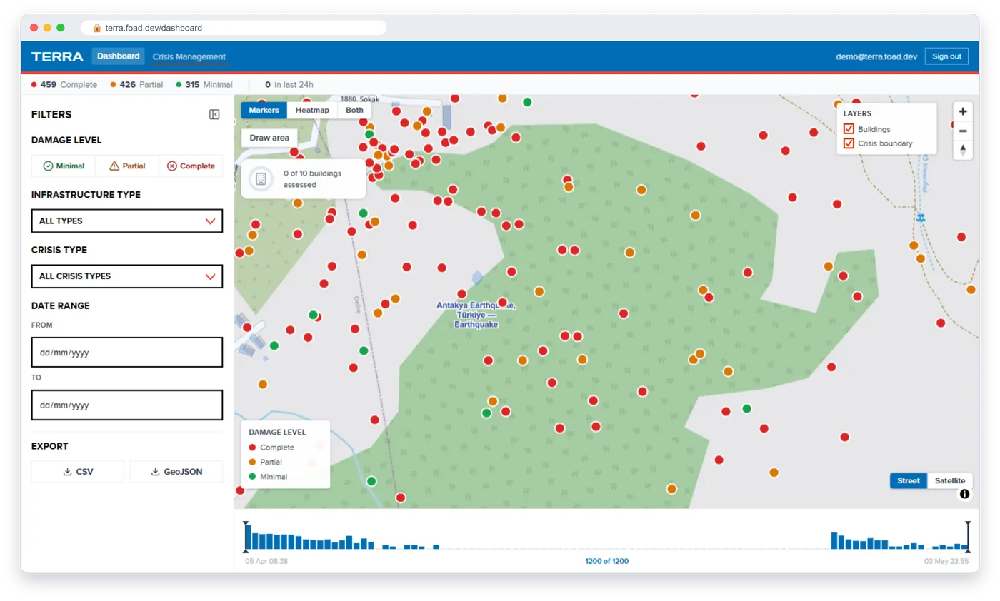
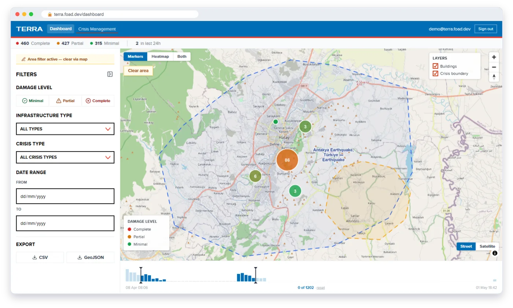
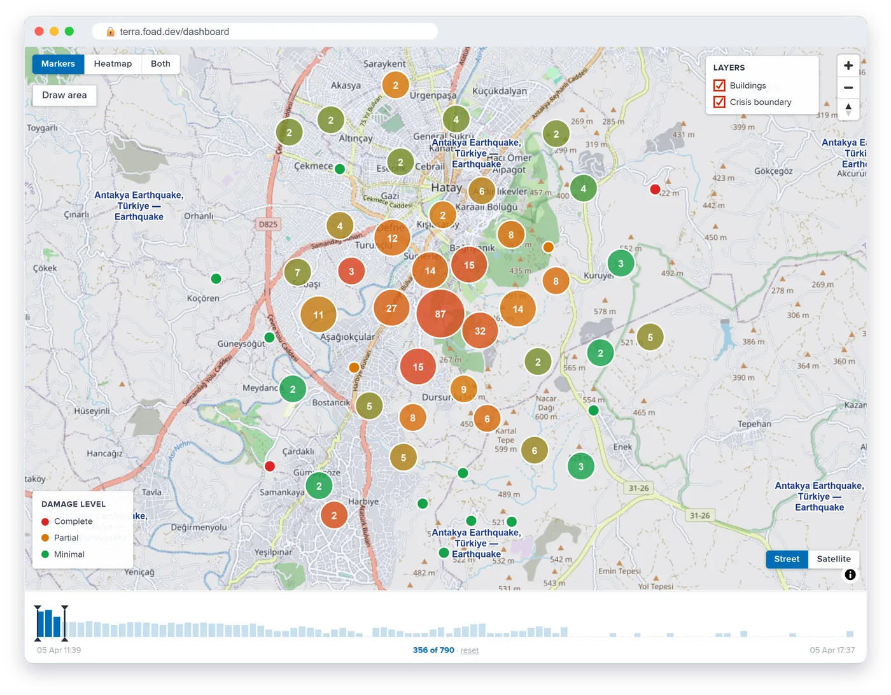
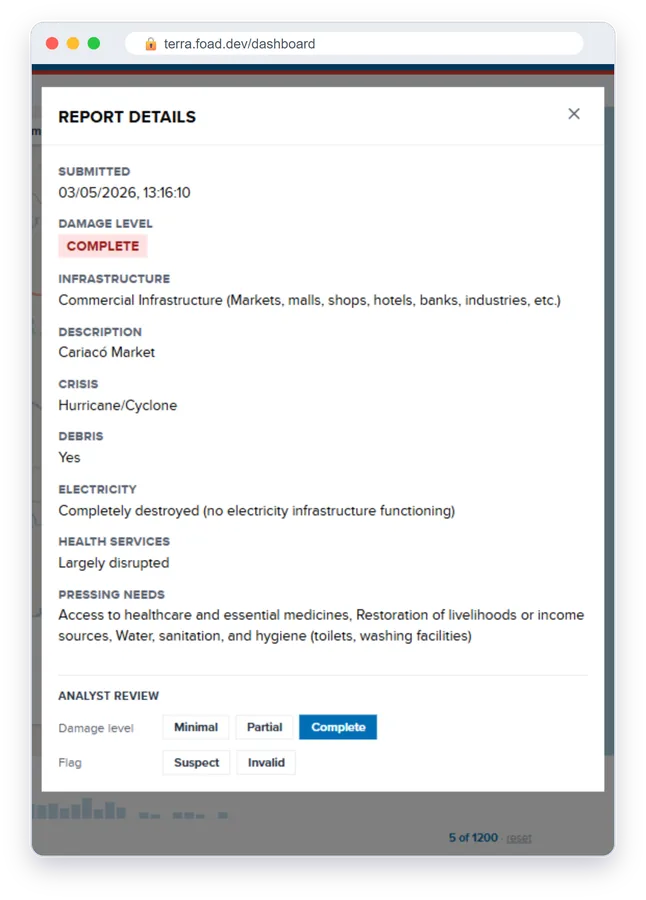
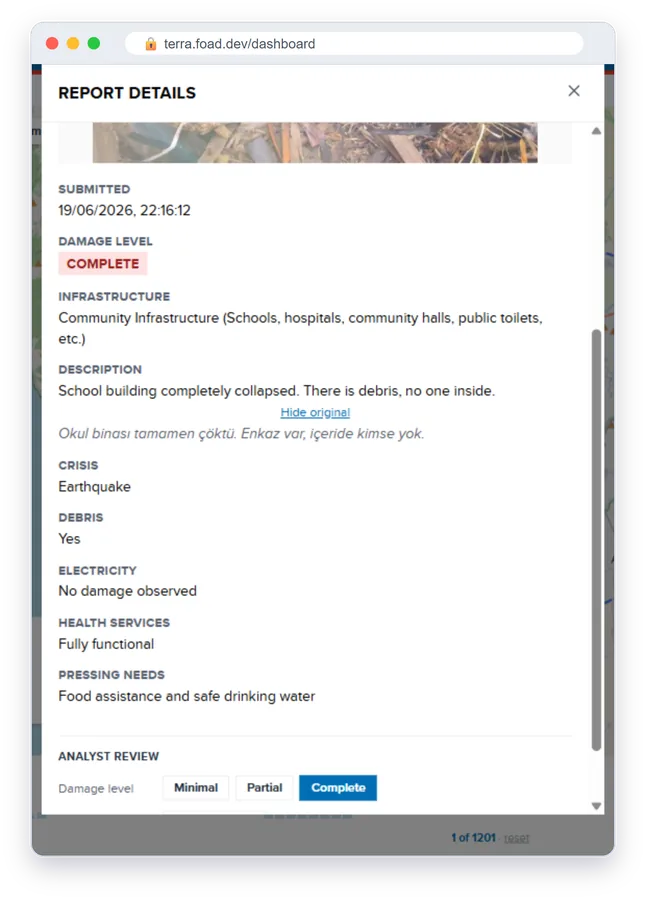
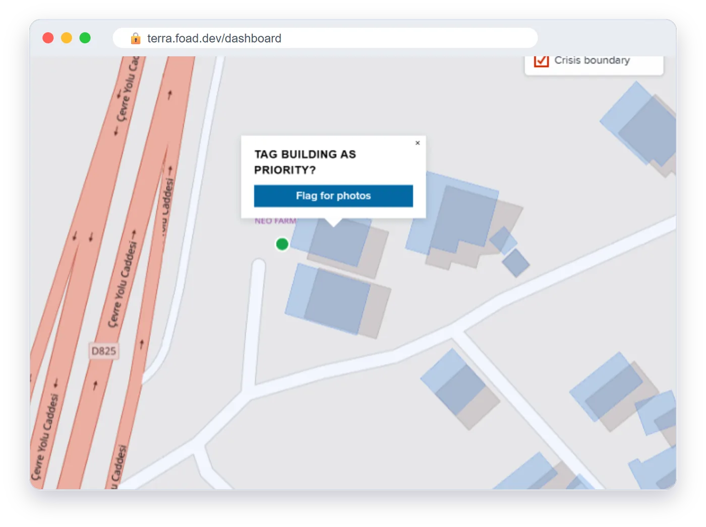

# Analyst guide: the TERRA dashboard

The dashboard shows the community reports for a crisis. Analysts use the dashboard to examine the reports, to request more photos and to export the data.

## Sign in

1. Open `/dashboard`, for example `https://terra.foad.dev/dashboard`.
2. Select **Sign in**.
3. Enter the credentials of your analyst account.

The bar below the header shows the number of current reports at each damage level: **Complete**, **Partial** and **Minimal**. The bar also shows the number of reports that arrived **in last 24h**. The dashboard requests new reports every 30 seconds, so a refresh of the page is not necessary.

## The map

| Control | Function |
|---|---|
| **Markers** / **Heatmap** / **Both** | **Markers** shows one marker for each report, in the colour of its damage level. At a low zoom level, the markers become numbered clusters. Select a cluster to zoom in. |
| **Street** / **Satellite** | Changes the basemap. Use **Satellite** to compare the reports with imagery. |
| **Layers** | Shows or hides the **Buildings** outlines and the **Crisis boundary**. |

Select one marker to open **Report details**.

## Filters

The **Filters** panel on the left contains these filters:

- **Damage Level**: Minimal, Partial or Complete
- **Infrastructure Type**
- **Crisis Type**
- **Date Range**: **From** and **To**

### Filter by area

1. Select **Draw area** on the map.
2. Click on the map to add each point around the area.
3. Double-click to complete the area.

The map then shows only the reports inside the area, and the panel shows **Area filter active — clear via map**. To remove the area, select **Clear area**. To stop before the area is complete, select **Cancel**.

## Filter by time

The timeline below the map shows the time at which each report arrived. Drag the handles to select a time window, for example the first six hours. The count in the middle of the timeline shows the number of reports in the window, for example **356 of 790**. Select **reset** to show all the reports again.

## Read a report

**Report details** shows the photo, the damage level, the infrastructure type and the answers of the reporter.

- **Description** is in English. TERRA translates a description from a different language automatically. Select **Show original** to read the words of the reporter.
- **Location described as** shows the landmark that the reporter typed. This field appears only when the reporter typed a landmark.

  
  

## Analyst review

The **Analyst review** section at the bottom of **Report details** contains the review controls. TERRA keeps the original answer of the reporter after each change.

| Action | Procedure | Result |
|---|---|---|
| Reclassify | Under **Damage level**, select minimal, partial or complete | The report uses your damage level. A note shows the level that the community reported. Select **Restore** to cancel the change. |
| Request a photo | Under **Photo request**, select **Request photo** | The button changes to **Requested**. The building gets a purple dashed outline on the map of the reporters, with **Photos needed here**. This control appears only for a report that has a building. |
| Flag | Under **Flag**, select **Suspect** or **Invalid** | The report shows "Flagged as … — excluded from exports" and stays out of every server export. Select **Remove flag** to cancel the flag. |

### Request photos of a building that has no report

1. Zoom in until the building outlines appear.
2. Select the building.
3. In the **Tag building as priority?** box, select **Flag for photos**.

The box then shows **Priority flagged**, and the building gets a purple dashed outline on the map of the reporters. To remove the flag, select the building again and select **Remove flag**.

## Export

Under **Export** in the **Filters** panel, select **CSV** or **GeoJSON**.

- The export obeys the filters: damage level, infrastructure type, crisis type and dates. It contains a maximum of 1,000,000 rows. Each location appears once, with its most recent assessment.
- The export does not contain the reports that are flagged **Suspect** or **Invalid**.
- When an area filter is active, the browser builds the export from the reports inside the area. This export **does** contain flagged reports. Remove them before you share the file.
- The fields follow the UNDP Household and Building Damage Assessment (HBDA). QGIS and ArcGIS can open the GeoJSON file directly.

For the full list of fields, see the [API reference](../api-reference.md). For the storage of the reports and the building versions, see the [database schema](../database-schema.md).
