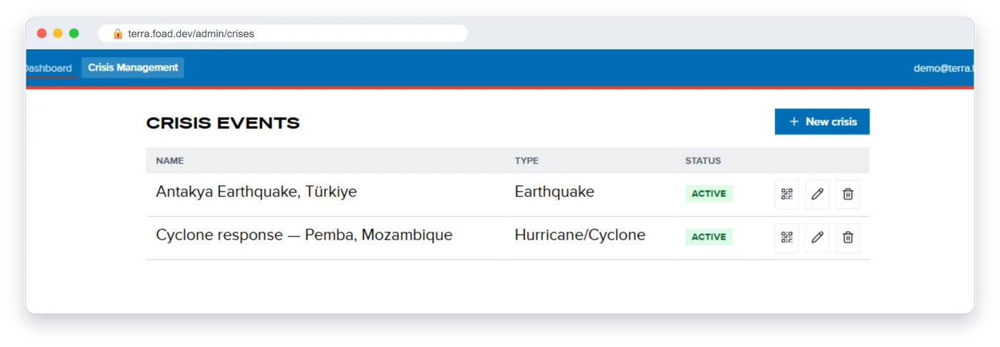
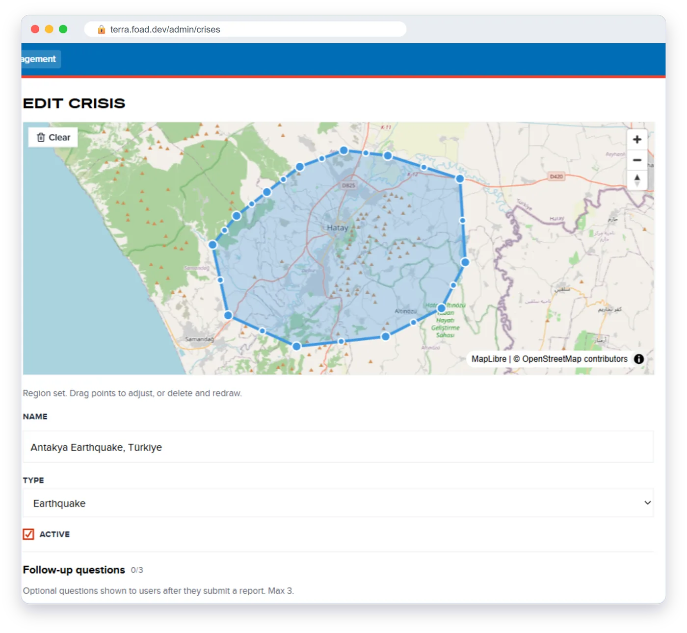
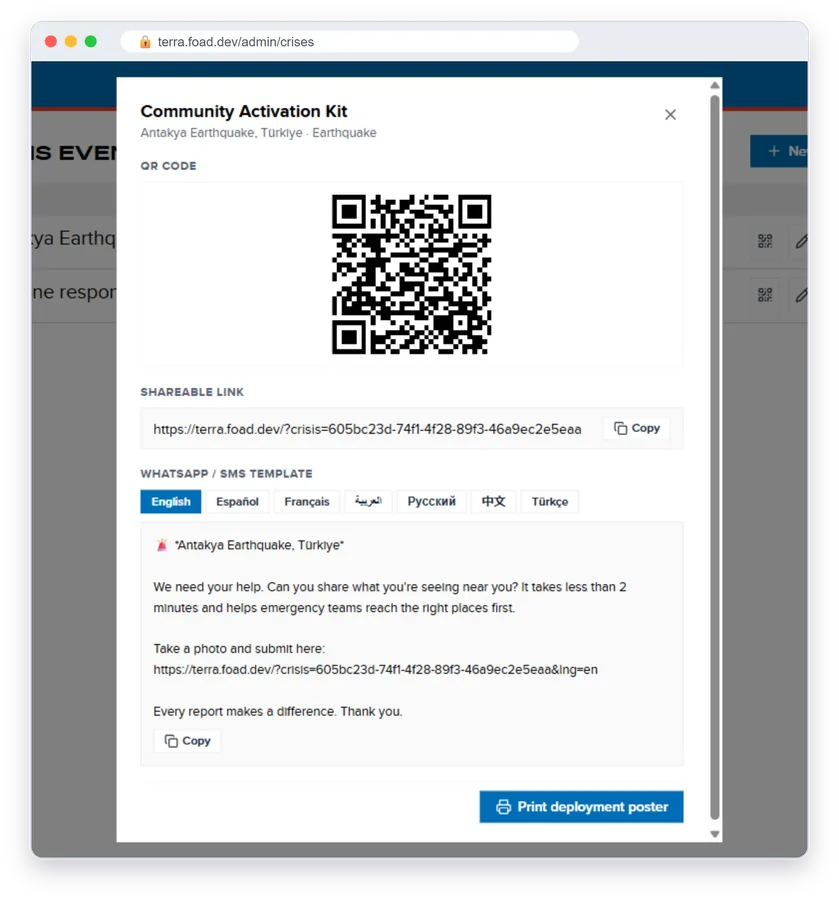

# Crisis deployment runbook

This runbook tells you how to set up TERRA for a new crisis. It also tells you how to give the link to the community.

Prerequisite: an analyst account.

Crisis setup occurs in **Crisis events** (`/admin/crises`). The dashboard header contains the link to this page.

The **Crisis events** list shows each crisis with its type and its status, **Active** or **Inactive**. Each row has three buttons: **Activation Kit** (QR code icon), **Edit** (pencil icon) and **Delete** (bin icon). More than one crisis can be active at the same time.

## 1. Create the crisis

1. Select **New crisis**.
2. Click on the map to draw the region of the crisis. Double-click to finish. To adjust the region, drag its points.
3. In **Name**, type the name that the reporters will see, for example "Antakya Earthquake, Türkiye".
4. In **Type**, select the crisis type, for example Earthquake, Flood or Conflict. The type sets the suggested follow-up questions.
5. Keep **Active** selected, so that the crisis goes live after the save.

The region sets the area on which the map opens for the reporters inside it. The region also sets the follow-up questions that these reporters receive. Draw the region around the full affected area. Building outlines are available for every country, so no map data preparation is necessary.

## 2. Add follow-up questions (optional)

**Follow-up questions** are extra questions that a reporter receives after a submission. The heading above them gives the number of questions, for example **One quick question while you're here:**. A crisis can have a maximum of three follow-up questions.

1. Select a question under **Suggested for [crisis type]:**, or select **Write custom question**.
2. Under **Answer options**, type the options for the question. Select **Add option** for each additional option.
3. If an open answer is necessary, select **Include "Other — please specify" option**.

Keep the questions short. Each additional question reduces the number of completed reports. The core damage questions are the same for every crisis, so that the data stays comparable.

Select **Save**. This button is available after the crisis has a name and a region.

## 3. Publish the Activation Kit

Select the **Activation Kit** button on the row of the crisis. The **Community Activation Kit** has three parts:

- **QR Code**: for posters, flyers and screens.
- **Shareable link**: select **Copy** to copy the link.
- **WhatsApp / SMS template**: a prepared message in each language. Select the language tab, then select **Copy**. The link in each language opens TERRA in that language.

To produce a printable poster with the QR code, select **Print deployment poster**.

## 4. Go-live checks

- [ ] Open the shareable link on a phone. The map opens on the crisis area.
- [ ] Zoom in on several streets. The building outlines appear.
- [ ] Send the WhatsApp message to yourself in each language that you will use, then open each link.
- [ ] Submit one test report. On the dashboard, open the test report and flag it **Invalid**, so that it stays out of the exports.
- [ ] Give the poster and the message to the partners that will distribute them: the country office, the local NGOs and the community leaders.
- [ ] Brief the analysts that will monitor the dashboard. See the [analyst guide](analyst-guide.md).

## 5. Close a crisis

1. Select **Edit** on the row of the crisis.
2. Clear the **Active** checkbox.
3. Select **Save**.

The status changes to **Inactive**. The link no longer opens on the crisis area, and the follow-up questions stop. The reports that are already submitted stay on the dashboard and in the exports.

Use **Delete** only for a crisis that you created in error.

## Related

- [Reporter guide](reporter-guide.md): what the community sees
- [Analyst guide](analyst-guide.md): how to monitor, review and export the reports
- [Offline and connectivity scenarios](../offline-connectivity-scenarios.md)
