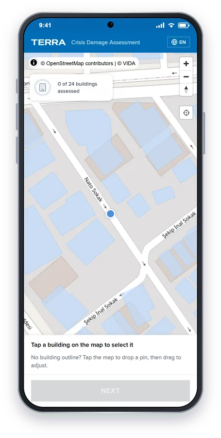
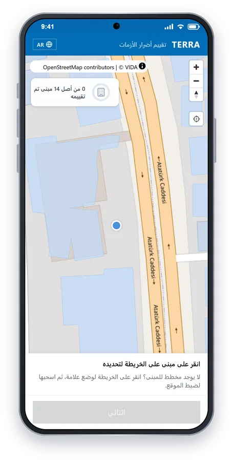
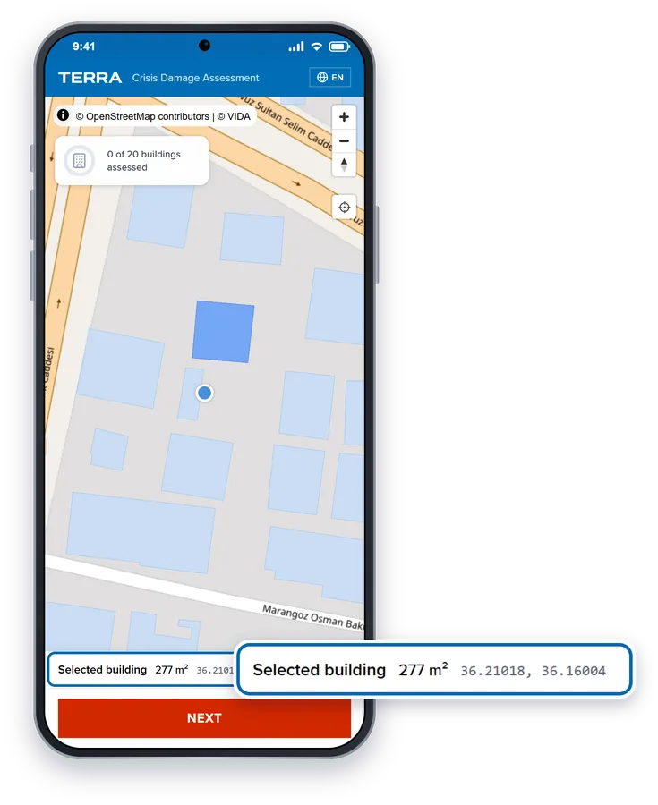
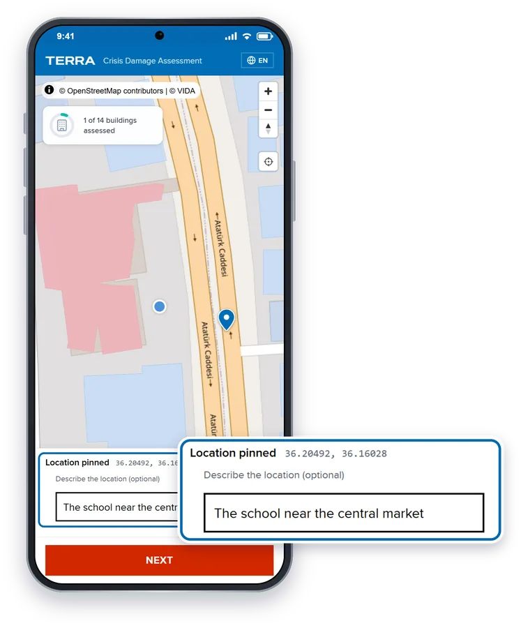
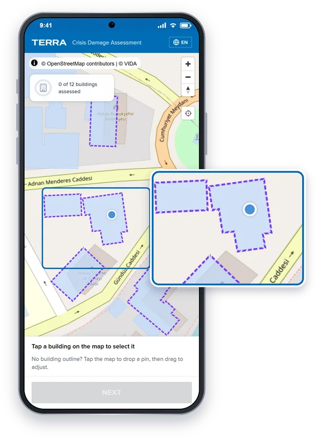
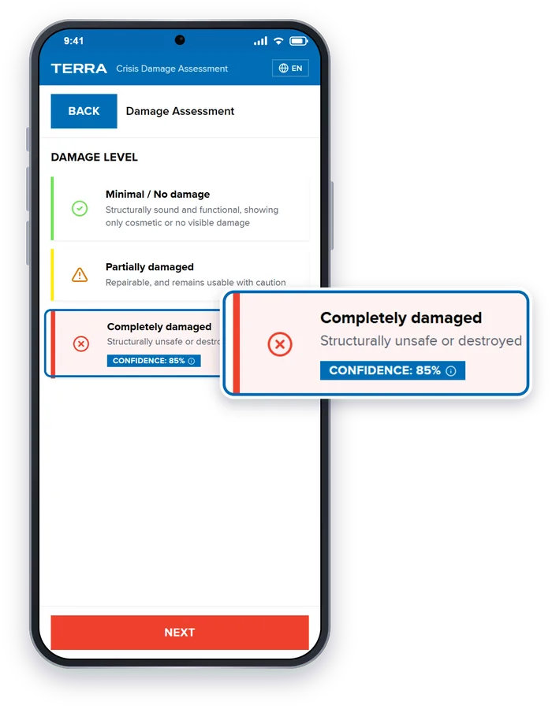
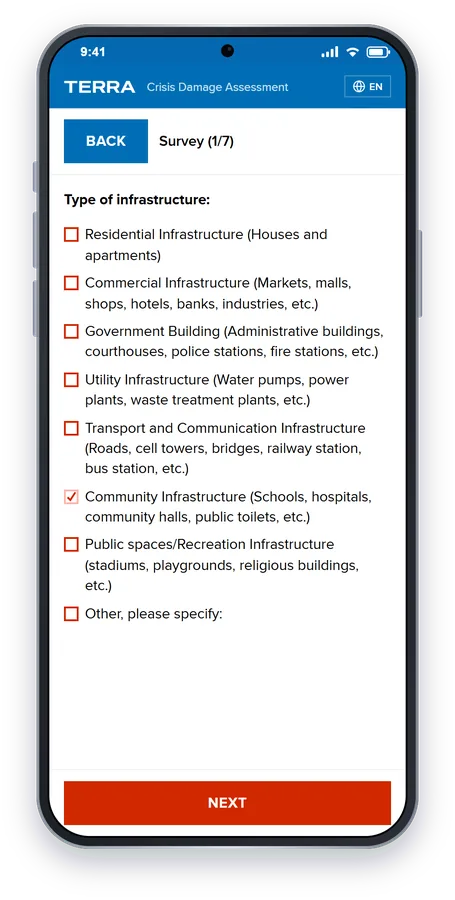
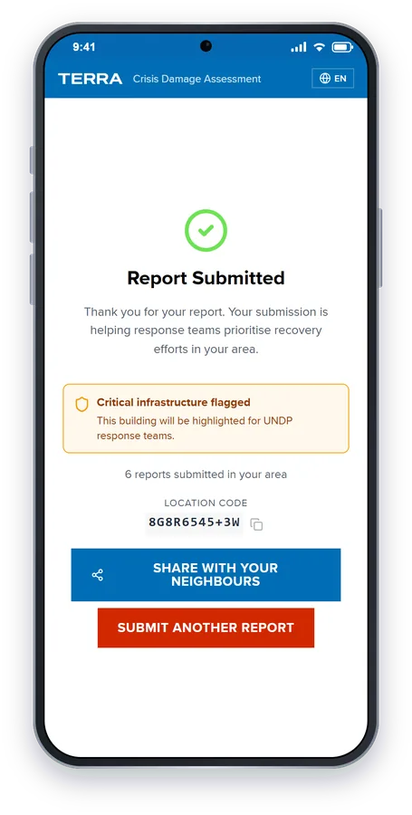
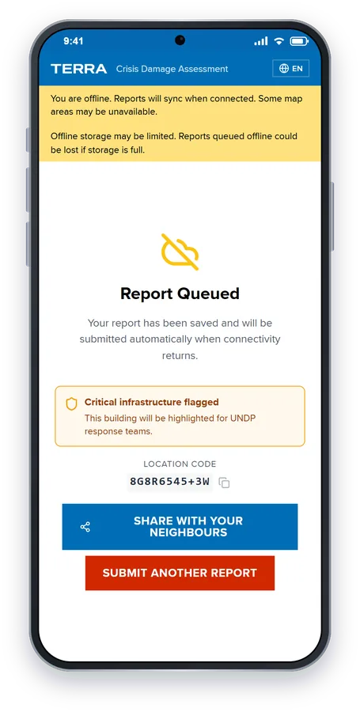

# Report damage with TERRA

This guide tells you how to report a damaged building. A report takes approximately two minutes.

You do not need an app, an account or a network connection. TERRA operates in the browser on your phone. If you are offline, TERRA keeps the report on your phone and sends it later.

> **WARNING**
>
> Do not enter a damaged building. Do not go near a damaged building. A damaged building can collapse and cause injury or death. Take the photo from a safe distance.

## 1. Open the link

1. Scan the QR code on a poster, or tap the link that you received on WhatsApp or by SMS. The map opens on the crisis area.
2. To change the language, tap the language code at the top right, for example **EN**.

TERRA is available in English, Arabic, Chinese, French, Russian, Spanish and Turkish.

  
  

## 2. Choose the building

1. Tap a building on the map. The building changes to blue. The bottom of the screen shows the area and the coordinates of the building.
2. If the building has no outline, tap the map to put a pin on the building. Then drag the pin to the correct position.
3. Under **Describe the location (optional)**, type the nearest landmark, the street name or the building name. For example, "the school near the central market".
4. Tap **Next**.

  
  

A purple dashed outline identifies a building. The response team needs photos of this building. When you tap the building, the screen shows **Photos needed here**. Report this building if you can reach it safely.

## 3. Take the photo

1. Tap **Take Photo**, or tap **Choose from Gallery** to use a photo from your phone.
2. Wait until the upload is complete.

A photo is necessary. You must add a photo before you continue.

TERRA removes the location and the camera details from the photo on your phone before it sends the photo. If you are offline, the screen shows **Photo saved — will upload when online**.

## 4. Choose the damage level

Select the option that describes the building:

| Option | Meaning |
|---|---|
| **Minimal / No damage** | Structurally sound and functional, showing only cosmetic or no visible damage |
| **Partially damaged** | Repairable, and remains usable with caution |
| **Completely damaged** | Structurally unsafe or destroyed |

TERRA can suggest an option and show a confidence value, for example **Confidence: 85%**. The suggestion is not a decision. Select the option that you think is correct.

## 5. Answer the survey

The survey shows one question on each screen. Two questions are necessary:

- **Type of infrastructure:**
- **Nature of the crisis:**

These questions are optional:

- debris that needs clearing
- the condition of the electricity supply and the health services in your area
- the most pressing needs of your community
- a description of the building and the damage, in your own language

Do not type names or telephone numbers in the description. TERRA removes them automatically, but do not include them.

Tap **Submit Report**.

## 6. Finish

**Report Submitted** shows that the report reached the response team.

**Report Queued** shows that you are offline. TERRA keeps the report on your phone and sends it automatically when the connection returns. No other action is necessary.

  
  

From this screen you can do these tasks:

- Tap **Share with your neighbours** to send the link to other people.
- Tap **Submit Another Report** to report a different building.
- Tap **Copy location code** to copy the **Location code**. This code identifies the exact position without an address.

## Your privacy

- TERRA does not ask for your name, an account or a telephone number.
- TERRA removes the location and the camera details from the photo on your phone, and again on the server.
- TERRA removes names, telephone numbers and email addresses from the text that you type.
- Only the response team can see the exact location of a report. The public map shows the number of buildings that are assessed. It does not show who made the reports.
